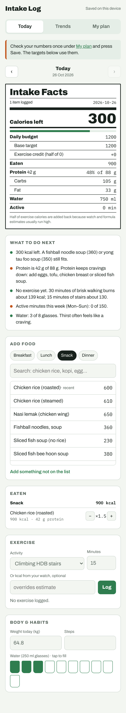

# Intake Log

A calorie, protein, exercise and weight tracker built for quick logging of Singapore food. It's a Blazor WebAssembly PWA on .NET 10 with an Azure Functions API: it installs to an iPhone home screen, works offline, and syncs between your phone and laptop through Azure Static Web Apps and Table Storage.



## Features

- **One-tap food logging**: about 55 Singapore staples (chicken rice, yong tau foo, kopi-O kosong, bubble tea), plus your recent and saved foods first. Half-portion steps.
- **AI food search** (optional): ask Google Gemini about any food not on the list and get calories, protein, carbs, fat, fibre, sugar and sodium for a typical Singapore serving. Uses your own free Gemini API key from [Google AI Studio](https://aistudio.google.com/apikey), entered under **My plan → AI food search**; it is stored only in this browser and left out of backups. The free tier has daily limits, and Google may use free-tier searches to improve its products. Foods you add from AI results are saved to My foods, so repeats are free.
- **Daily panel** styled like a nutrition label: calories left, protein against target, carbs, fat, water, active minutes.
- **Exercise** with no-equipment presets (HDB stairs, brisk walk, bodyweight circuit). Calories are estimated from MET values, or you can enter your watch's number. Only half is added back to your budget.
- **Suggestions** based on the day: how long to walk off an overage, low protein, no movement yet, weekly 150-minute target, plateau warning.
- **Trends**: 7-day average weight against goal, 14-day calorie bars, logging streak.
- **Plan**: Mifflin-St Jeor BMR and TDEE, target held at a 1,200 kcal (female) or 1,500 kcal (male) floor, estimated goal date.
- **Sync** between devices after signing in with a Microsoft or GitHub account.
- **Backup**: export and import all data as JSON.

## How sync works

- Every device keeps a full copy in `localStorage` and works offline. Logging never waits for the network.
- Each day, the profile and the saved-food list sync separately and carry their own edit time. Where two copies differ, **the newer edit wins**. If you edit the same day on two devices before they sync, the later edit replaces the earlier one for that day.
- Changes upload 2 seconds after you make them. Downloads happen at start-up, when the app returns to the foreground, when the network comes back, and every 3 minutes.
- The API only accepts signed-in users, and each user's rows are stored under their own partition. Set `ALLOWED_USERS` so only your account can use it.

## Project layout

```
IntakeLog.slnx
├─ src/IntakeLog.Core          Models, calculations, presets, suggestions, sync merge rules (no UI)
├─ src/IntakeLog.Web           Blazor WebAssembly PWA
│  ├─ Pages/                   Home (Today), Trends, PlanPage
│  ├─ Components/              FactsPanel, WeightChart, CalorieChart, StateComponent
│  ├─ Services/AppState.cs     Device copy + localStorage persistence
│  ├─ Services/SyncService.cs  Sign-in status, upload/download, retry
│  └─ wwwroot/staticwebapp.config.json  Routes, auth rules, API runtime
├─ src/IntakeLog.Api           Azure Functions (isolated, .NET 10): GET/POST /api/sync
├─ tests/IntakeLog.Core.Tests  Calculations, insights, sync merge
├─ tests/IntakeLog.Api.Tests   Auth header parsing, server merge, Table Storage
└─ .github/workflows/azure-static-web-apps.yml  Test, publish, deploy
```

## Set up Azure (one time, about 15 minutes)

Everything below runs on free or near-free tiers. Expect well under US$1 a month for Table Storage at this size.

### 1. Storage account

1. In the Azure portal: **Create a resource → Storage account**.
2. Region: **Southeast Asia**. Performance: **Standard**. Redundancy: **LRS**.
3. Once created, open it → **Security + networking → Access keys** → copy **Connection string** for key1.

### 2. Static Web App

1. **Create a resource → Static Web App**.
2. Plan: **Free**. Region: **East Asia** (closest available).
3. Deployment details: Source **Other**. (The GitHub workflow in this repo deploys it, so the portal shouldn't create its own.)
4. Once created: **Overview → Manage deployment token** → copy the token.
5. **Settings → Environment variables** → add:
   - `TABLES_CONNECTION_STRING` = the connection string from step 1
   - `ALLOWED_USERS` = the email of your Microsoft account, or your GitHub username (comma-separate several)
6. Click **Apply**.

### 3. GitHub

1. In the repository: **Settings → Secrets and variables → Actions → New repository secret**.
2. Name `AZURE_STATIC_WEB_APPS_API_TOKEN`, value: the deployment token.
3. Push to `main`, or run the workflow from the **Actions** tab.

### 4. Each device

1. Open the Static Web App URL (**Overview → URL**).
2. On iPhone: Safari → Share → **Add to Home Screen**.
3. **My plan → Sync → Sign in** with the same account on every device.

Data already logged on a device uploads the first time it signs in.

## Run locally

Requires the [.NET 10 SDK](https://dotnet.microsoft.com/download).

UI only (no sync; data stays in the browser):

```bash
dotnet test
dotnet run --project src/IntakeLog.Web
```

With sync, using local emulators:

```bash
npm i -g azurite azure-functions-core-tools@4 @azure/static-web-apps-cli
azurite --silent &                                   # local Table Storage
cp src/IntakeLog.Api/local.settings.example.json src/IntakeLog.Api/local.settings.json
(cd src/IntakeLog.Api && func start) &               # API on :7071
dotnet publish src/IntakeLog.Web -c Release -o out/web
swa start out/web/wwwroot --api-devserver-url http://localhost:7071   # app on :4280 with fake sign-in
```

Run the Table Storage integration test against Azurite with `TABLES_TEST_CONNECTION=UseDevelopmentStorage=true dotnet test`.

## Changing the numbers

- AI food search prompt, model and response format: `src/IntakeLog.Core/AiFoodSearch.cs`
- Food presets and activities: `src/IntakeLog.Core/Presets.cs`
- Formulas, calorie floor, exercise credit share: `src/IntakeLog.Core/Calculator.cs`
- Suggestion rules and plateau detection: `src/IntakeLog.Core/Insights.cs`

## Caveats

Hawker calorie values are typical-portion estimates and vary by stall. BMR and exercise burn are formula estimates. Adjust your target after 3–4 weeks based on your weight trend. This app isn't medical advice.
